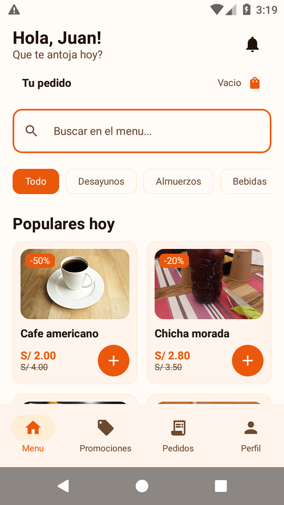
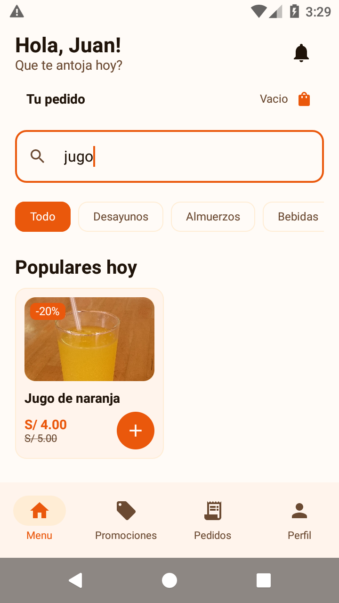
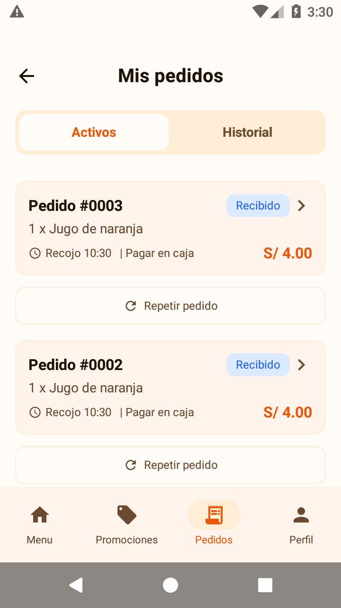
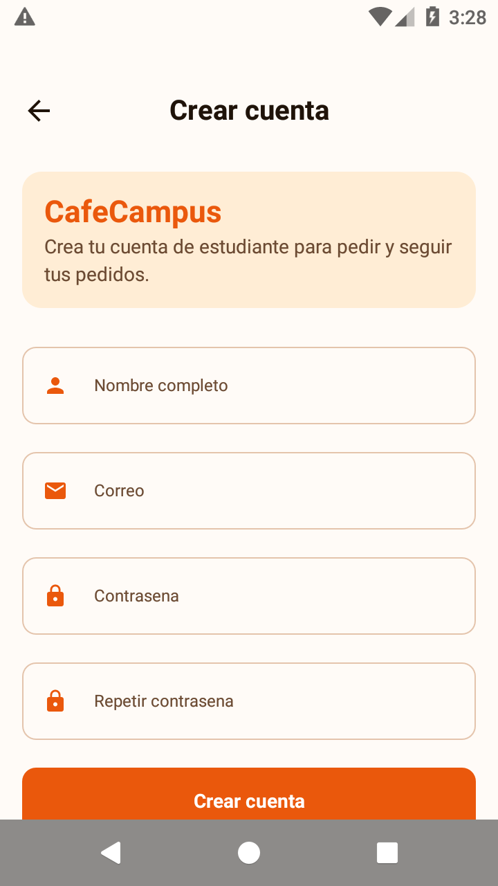
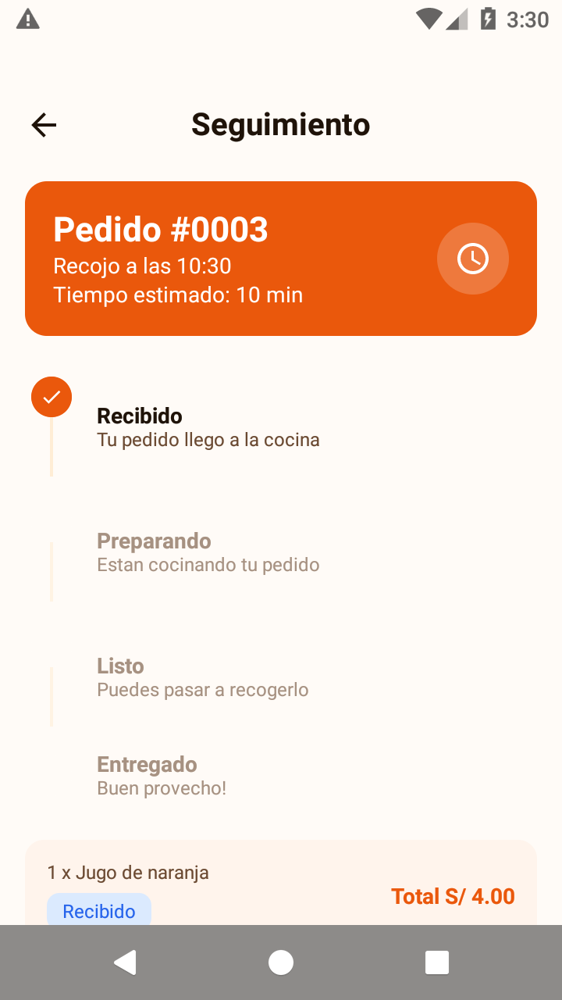
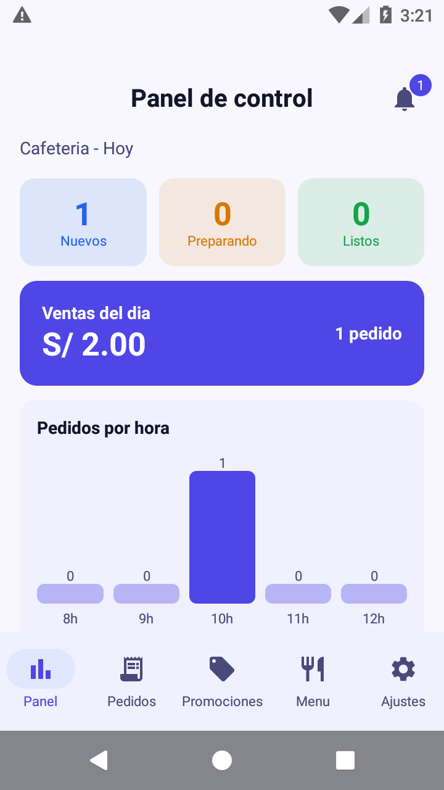
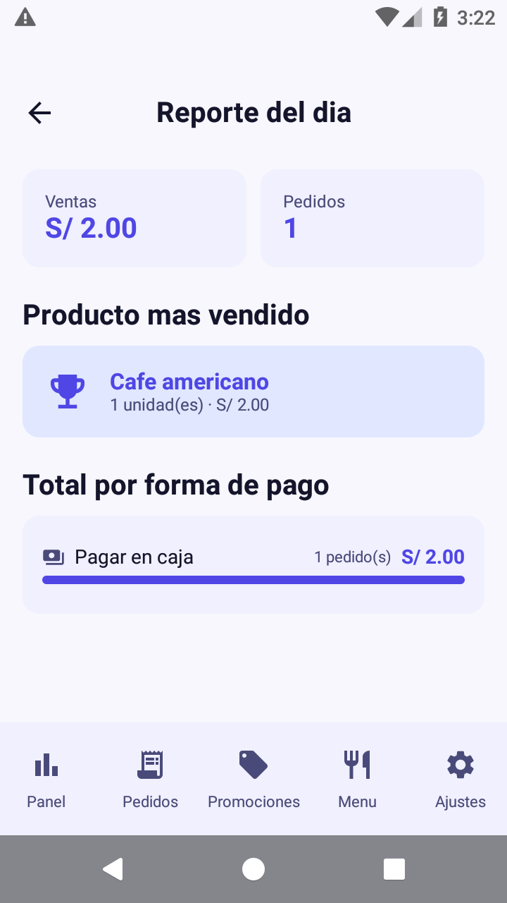
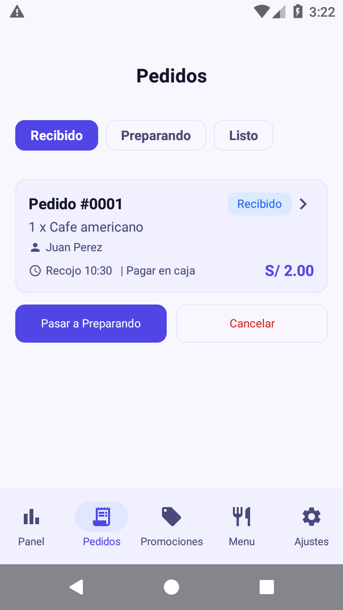
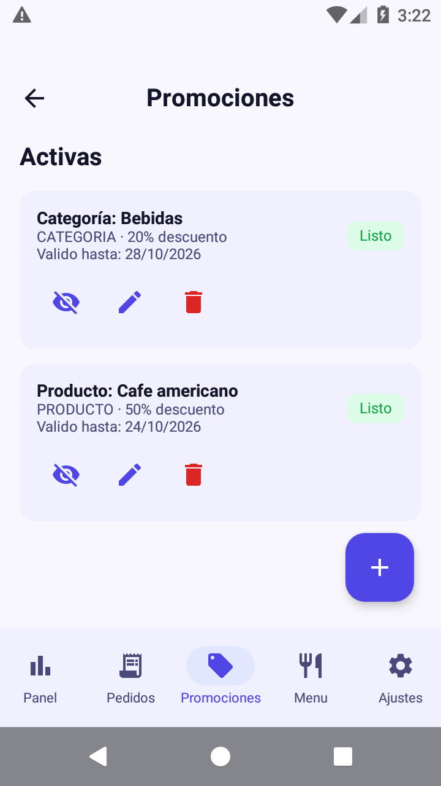
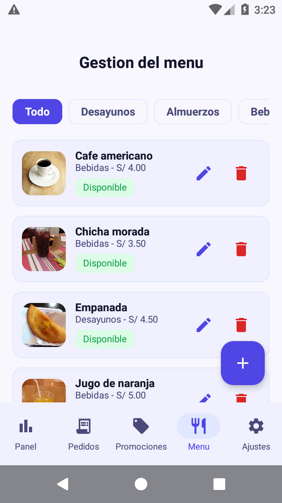

# CafeCampus (Con-IA)

**Laboratorio MVVM + Room — Semana 08 (Fase 2, con IA)**
TECSUP · Programación en Móviles · 4to Ciclo · Diseño y Desarrollo de Software
**Juan León Suiyon**

> Rama `Con-IA`. Es la **Fase 2** del laboratorio: la app base de la
> [Fase 1](https://github.com/Jamestecsup/-Moviles_Android/tree/Sin-IA) (rama
> `Sin-IA`) más **5 mejoras** hechas con asistencia de IA, documentadas en
> [`PROMPTS.md`](PROMPTS.md).

---

## 1. Qué es CafeCampus

App de pedidos para la cafetería del campus, con **dos perfiles en el mismo
dispositivo** sobre una **única base de datos Room**:

- **Estudiante** — pide, sigue su pedido y puede repetir un pedido anterior.
- **Administrador** — atiende los pedidos, gestiona el menú y las promociones,
  y consulta el reporte del día.

Cuando el administrador cambia el estado de un pedido, el estudiante lo ve
reflejado **sin reiniciar la app**: las pantallas observan `Flow` de Room.

**Stack:** Kotlin · Jetpack Compose + Material 3 (sin XML) · Room 2.8.5 ·
DataStore · Navigation Compose · **MVVM + Repository (interface)**.

### Cuentas de prueba

| Perfil | Correo | Clave |
|---|---|---|
| Estudiante | `juan@campus.test` | `1234` |
| Administrador | `admin@cafe.test` | `admin` |

> Los datos son **ficticios** (Ley 29733). Las fotos de producto vienen de
> Wikimedia Commons con licencias libres (ver
> `app/src/main/assets/img/productos/ATRIBUCIONES.md`).

---

## 2. Mejoras de la Fase 2

| # | Mejora | Capas |
|---|---------|-------|
| 1 | **Repetir pedido** — botón en el historial que vuelve a cargar los productos al carrito | ViewModel + View |
| 2 | **Registro de estudiante** — pantalla de cuenta nueva con validaciones y correo único | DAO + Repository + ViewModel + View |
| 3 | **Reporte del día** — producto más vendido y total por forma de pago, con consultas reales de Room | DAO + Repository + ViewModel + View |
| 4 | **Animaciones y estados vacíos** — stepper animado, transiciones e ilustraciones | View |
| 5 | **Buscar en el menú** — el filtro pasa al `MenuViewModel` (`combine` de `StateFlow`) | ViewModel + View |

Los prompts usados, lo que generó la IA, lo que hubo que corregir a mano y la
reflexión están en [`PROMPTS.md`](PROMPTS.md).

---

## 3. Capturas

### Perfil Estudiante

| Menú con promociones | Buscar en el menú | Repetir pedido |
|---|---|---|
|  |  |  |

| Crear cuenta (nuevo) | Seguimiento del pedido |
|---|---|
|  |  |

### Perfil Administrador

| Panel de control | Reporte del día (nuevo) | Pedidos por estado |
|---|---|---|
|  |  |  |

| Gestión de promociones | Gestión del menú |
|---|---|
|  |  |

---

## 4. Estructura de paquetes

```
com.huaman.cafecampus
├── CafeApp.kt                     Application: base Room + siembra de datos
├── MainActivity.kt                arma NavCafe + CafeTheme(rol)
├── data
│   ├── local
│   │   ├── CafeDatabase.kt        singleton Room (cafecampus.db), version 3
│   │   ├── DatosIniciales.kt      6 productos, 2 usuarios, 2 promociones
│   │   ├── entity                 Producto · Usuario · Pedido · DetallePedido
│   │   │                          Promocion
│   │   ├── dao                    ProductoDao · UsuarioDao · PedidoDao
│   │   │                          PromocionDao
│   │   └── relation               PedidoConDetalle · ProductoVendido
│   │                              TotalPorPago
│   ├── prefs
│   │   └── PreferenciasStore.kt   DataStore (perfil, modo oscuro, pedidos)
│   └── repository
│       ├── CafeRepository.kt        EL CONTRATO (interface)
│       └── CafeRepositoryRoom.kt    la única que conoce los DAOs
├── model                           Rol · EstadoPedido · ItemCarrito
│                                   ProductoEnOferta · CalculoPromociones
├── viewmodel
│   ├── CafeViewModelFactory.kt     ViewModels compartidos
│   ├── MenuViewModel.kt            carta, promociones, búsqueda y carrito
│   ├── SesionViewModel.kt          login, registro y preferencias
│   ├── PedidosClienteViewModel.kt  confirmar, seguir y repetir pedido
│   ├── PanelAdminViewModel.kt      panel de control
│   ├── PedidosAdminViewModel.kt    bandeja por estado
│   ├── MenuAdminViewModel.kt       alta/edición/baja del menú
│   ├── PromocionesViewModel.kt     crear/editar/activar/eliminar promociones
│   └── ReporteViewModel.kt         reporte del día
└── ui
    ├── theme                       Color · Type · Theme (CafeTheme(rol))
    ├── components                  AppTopBar · CafeButton · CafeTextField
    │                               EstadoChip · EstadoVacio · ProductoCard
    │                               ProductoIcono · ImagenProducto · PedidoCard
    │                               StepperEstado
    ├── navigation                  Rutas · NavCafe
    ├── cliente                     Splash · Login · Registro · Menu
    │                               DetalleProducto · ConfirmarPedido
    │                               Seguimiento · MisPedidos · Perfil
    │                               Promociones
    └── admin                       Panel · PedidosAdmin · DetallePedidoAdmin
                                    MenuAdmin · FormularioProducto
                                    FormularioPromocion · Reporte · Ajustes
```

---

## 5. Base de datos

`app/src/main/assets/db/cafecampus.sql` es la fuente de verdad del esquema
(5 tablas). Room genera exactamente esas tablas.

| Tabla | Columnas | Claves |
|---|---|---|
| `usuarios` | id, nombre, correo, clave, rol | **PK** `id` · **candidata** `correo` UNIQUE |
| `productos` | id, nombre, descripcion, categoria, precio, disponible, icono, imagenRuta | **PK** `id` · **candidata** `nombre` UNIQUE |
| `pedidos` | id, clienteId, estado, horaRecojo, pago, nota, total, fecha | **PK** `id` · **FK** `clienteId` → `usuarios.id` |
| `detalle_pedido` | id, pedidoId, productoId, nombreProducto, cantidad, precioUnitario | **PK** `id` · **FK** `pedidoId` → `pedidos.id` (CASCADE) · **compuesta** `(pedidoId, productoId)` UNIQUE |
| `promociones` | id, tipo, valorReferencia, descuentoPorcentaje, fechaInicio, fechaFin, activo | **PK** `id` · **compuesta** `(tipo, valorReferencia)` UNIQUE |

### Reglas de negocio

- **Estados del pedido:** `RECIBIDO → PREPARANDO → LISTO → ENTREGADO`, con
  `CANCELADO` aparte.
- **Promociones:** aplican a **un producto** o a **una categoría** entera. Si un
  producto tiene ambas, **gana la del producto** (es más específica). Solo
  cuentan las vigentes (`activo` y dentro de `fechaInicio`/`fechaFin`).
- **El pedido guarda el precio final**: es una foto del momento, así que si
  luego se edita la promoción, ese pedido no cambia.

---

## 6. 9. Para pensar

| Pregunta | Tu respuesta |
|---|---|
| ¿Por qué el Repository es una interface? | Para que la app dependa del *contrato* y no de SQLite: mañana puede hablar con un servidor sin tocar ni un ViewModel ni una pantalla. |
| ¿Por qué `crearPedido` es suspend y `observarPedidosCliente` es Flow? | `crearPedido` cambia datos una sola vez: se espera y listo. `observar...` debe *avisar* cuando cambian, así que emite el pedido actual y cada vez que otro perfil lo modifique. |
| ¿Qué pasaría si dos perfiles usaran bases de datos distintas? | El estudiante vería un pedido que el administrador nunca vería: se rompería justo lo central del laboratorio, que es que el admin actúa y el estudiante lo ve al instante. |
| ¿Qué debería cambiar si mañana los datos viven en un servidor? | Solo `CafeRepositoryRoom`: una implementación nueva de la misma interface. Los ViewModels, las pantallas y el tema no se tocan. |

---

## 7. Cómo compilar

```bash
# desde la carpeta CafeCampus(Con-IA)
./gradlew :app:assembleDebug

# instalar en el emulador / dispositivo
adb install -r app/build/outputs/apk/debug/app-debug.apk
```

- Requiere **Android Studio** (o el SDK de Android) y **JDK 17**.
- `local.properties` no se versiona: se genera al abrir el proyecto, o Gradle
  usa la variable `ANDROID_HOME`.
- Room + KSP: la versión de KSP en `gradle/libs.versions.toml` va fijada a la
  misma que la de Kotlin.
- Si cambias una entidad después de ejecutar la app, sube `version` en
  `CafeDatabase` o desinstala la app: si no, Room avisa con
  *"cannot verify the data integrity"*.

---

## 8. Commits de esta fase

| # | Mensaje | Mejora |
|---|---------|--------|
| 1 | `ia: copia el proyecto CafeCampus a la carpeta CafeCampus(Con-IA)` | base de la Fase 2 |
| 2 | `ia: agrega repetir pedido en el historial del estudiante` | Mejora 1 |
| 3 | `ia: agrega pantalla de registro de estudiante` | Mejora 2 |
| 4 | `ia: agrega reporte del dia con producto mas vendido y total por forma de pago` | Mejora 3 |
| 5 | `ia: agrega animaciones y estados vacios con ilustracion` | Mejora 4 |
| 6 | `ia: mueve el filtro de busqueda del menu al MenuViewModel` | Mejora 5 |
| 7 | `ia: agrega PROMPTS.md con los prompts usados` | documentación |
| 8 | `ia: agrega README.md con la documentacion de la entrega` | documentación |

La Fase 1 (rama `Sin-IA`) tiene los 13 commits del laboratorio, uno por paso.

---

*Fase 2 — Mejora profesional asistida por IA · TECSUP · Programación en Móviles*
