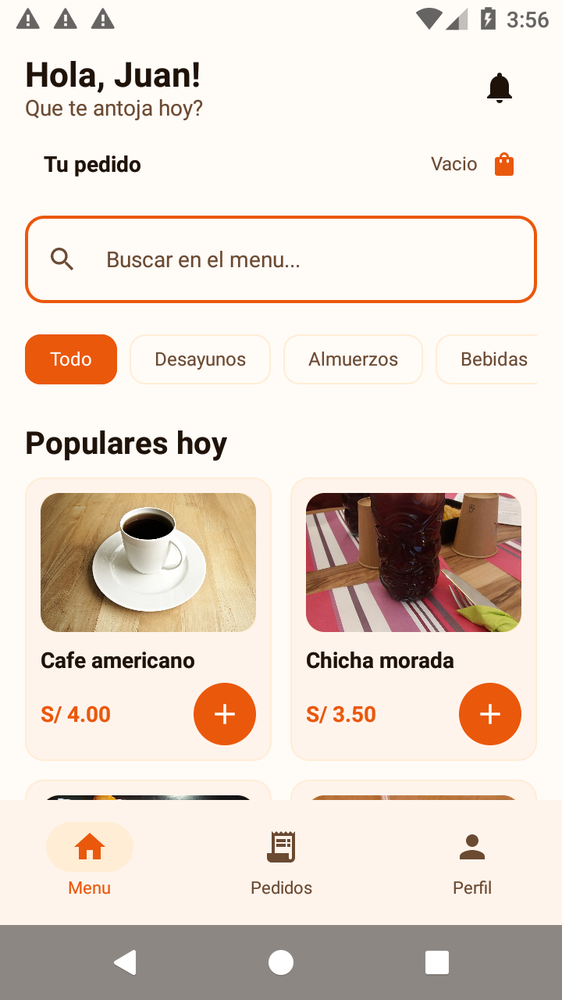
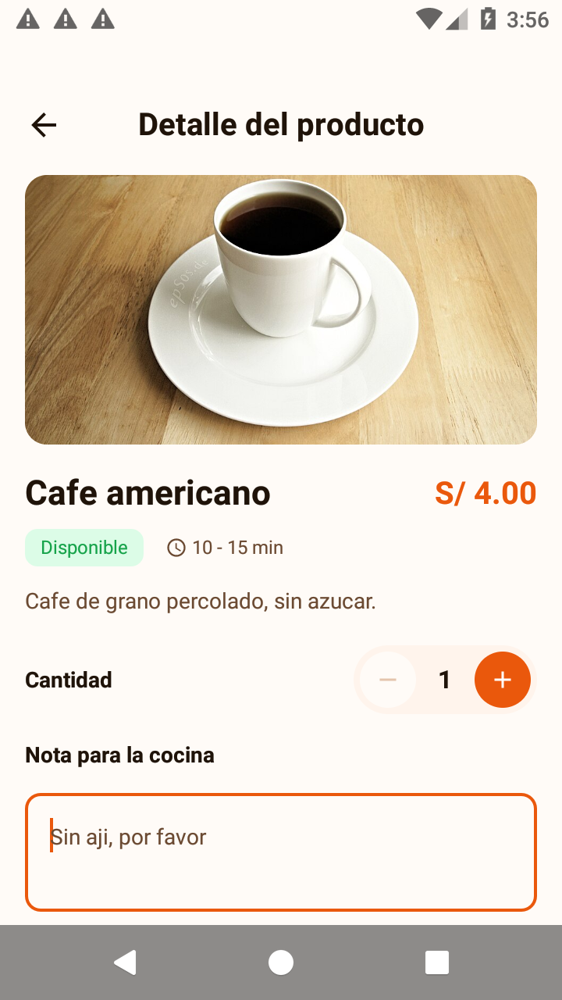
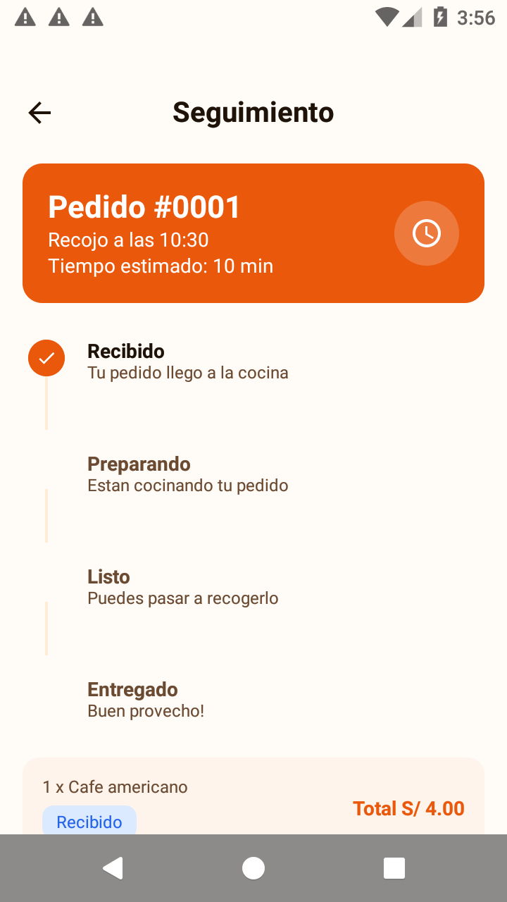
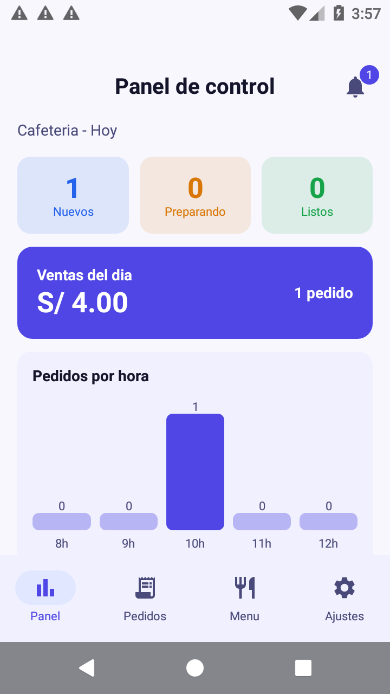
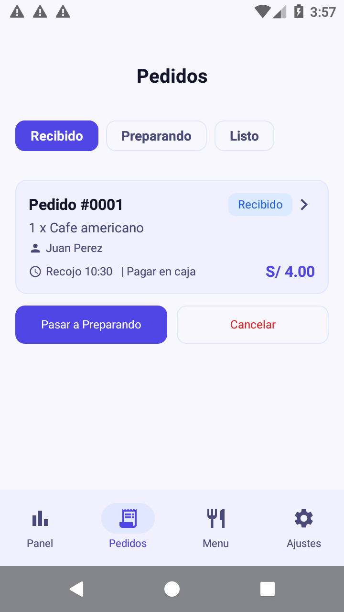
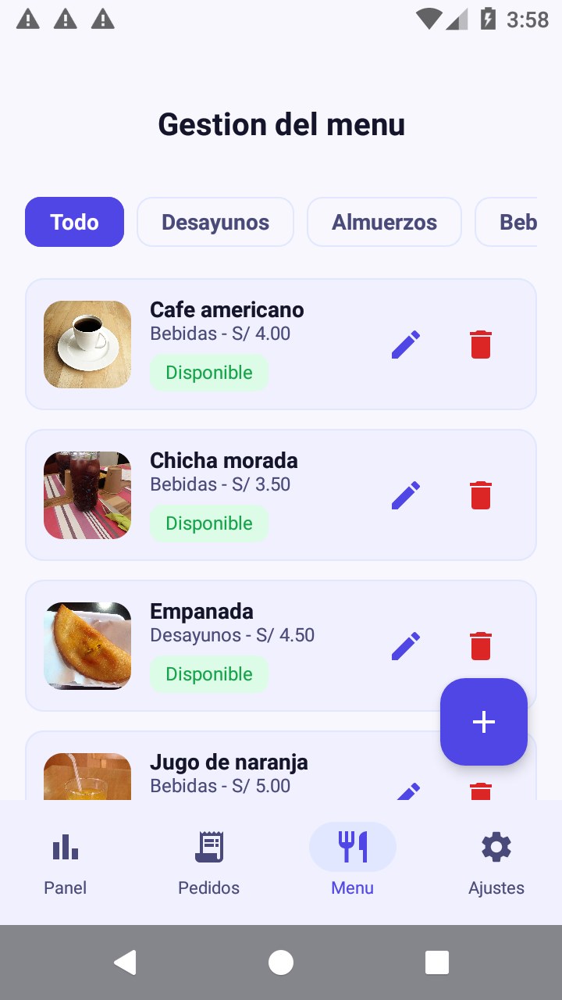

# CafeCampus

**Laboratorio MVVM + Room** — TECSUP · Programación en Móviles · Semana 08
Juan León Suiyon — 4to Ciclo — Diseño y Desarrollo de Software

---

## 1. Nombre y descripción

**CafeCampus** es una app de pedidos para la cafetería del campus. Tiene
**dos perfiles en el mismo dispositivo** y **una sola base de datos local**:

- **Estudiante** — entra al menú, agrega productos, confirma el pedido y sigue
  su estado en tiempo real.
- **Administrador** — ve el panel de ventas, atiende los pedidos por estado y
  administra el menú de la cafetería.

Cuando el administrador cambia el estado de un pedido, el estudiante lo ve
reflejado en su seguimiento **sin reiniciar la app**. Eso pasa porque los dos
perfiles comparten el mismo `cafecampus.db` y las pantallas observan **Flow**
de Room, no datos copiados.

Tecnología: **Kotlin + Jetpack Compose + Material 3 (sin XML) + Room +
DataStore + Navigation Compose**, patrón **MVVM + Repository (interface)**.

> Todos los datos son **ficticios** (Ley 29733 de protección de datos personales).
> Las fotos de producto vienen de Wikimedia Commons bajo licencias libres
> (ver `app/src/main/assets/img/productos/ATRIBUCIONES.md`).

### Cuentas de prueba

| Perfil | Correo | Clave |
|---|---|---|
| Estudiante | `juan@campus.test` | `1234` |
| Administrador | `admin@cafe.test` | `admin` |

---

## 2. Arquitectura MVVM

```
┌──────────────────────────────────────────────────────────────────┐
│  VIEW  (ui/)                                                     │
│  Composables: MenuScreen, SeguimientoScreen, PanelScreen, ...     │
│  · solo observan con collectAsStateWithLifecycle() y avisan       │
│  · NO conocen DAOs, ni Room, ni logica de negocio                │
└───────────────┬──────────────────────────────┬───────────────────┘
                │ StateFlow (abajo)            │ eventos (arriba)
                ▼                              ▲
┌──────────────────────────────────────────────────────────────────┐
│  VIEWMODEL  (viewmodel/)                                         │
│  MenuViewModel · SesionViewModel · PedidosClienteViewModel ·      │
│  PanelAdminViewModel · PedidosAdminViewModel · MenuAdminViewModel│
│  · estado con StateFlow + stateIn(...)                           │
│  · acciones unicas con viewModelScope.launch                     │
│  · reglas de negocio (p. ej. EstadoPedido.siguiente())           │
└───────────────┬──────────────────────────────┬───────────────────┘
                │                              │ (contrato)
                ▼                              │
┌──────────────────────────────────────────────────────────────────┐
│  REPOSITORY  (data/repository/)            ◄── interface          │
│  interface CafeRepository                   CafeRepositoryRoom   │
│  · solo la interfaz se ve desde arriba     · la unica que conoce  │
│  · permite cambiar SQLite por un servidor     los DAOs            │
└───────────────┬──────────────────────────────┘
                │
                ▼
┌──────────────────────────────────────────────────────────────────┐
│  DAO + ROOM  (data/local/)          SQLite: cafecampus.db        │
│  ProductoDao · UsuarioDao · PedidoDao                            │
│  · lectura que actualiza la pantalla -> Flow  (sin suspend)      │
│  · escritura / accion unica        -> suspend                    │
└──────────────────────────────────────────────────────────────────┘

┌──────────────────────────────────────────────────────────────────┐
│  PREFERENCIAS  (data/prefs/)            DataStore: ajustes       │
│  perfilActivo · modoOscuro · recibirPedidos · notificaciones    │
└──────────────────────────────────────────────────────────────────┘
```

**Regla de oro:** lo que debe *avisar* cuando cambia es `Flow`; lo que cambia
datos *una sola vez* es `suspend`. No se reemplazan, se complementan.

---

## 3. Base de datos: 4 tablas

El esquema completo está en **`app/src/main/assets/db/cafecampus.sql`**, que es
la fuente de verdad (las entidades Room generan exactamente esas tablas).

```
usuarios ──1─────N──► pedidos ──1─────N──► detalle_pedido
                        ▲                     │
                        │ productoId (NO es FK, es una foto del momento)
                   productos
```

| Tabla | Columnas | Claves |
|---|---|---|
| `usuarios` | id, nombre, correo, clave, rol | **PK** `id` · **candidata** `correo` UNIQUE |
| `productos` | id, nombre, descripcion, categoria, precio, disponible, icono | **PK** `id` · **candidata** `nombre` UNIQUE |
| `pedidos` | id, clienteId, estado, horaRecojo, pago, nota, total, fecha | **PK** `id` · **FK** `clienteId` → `usuarios.id` |
| `detalle_pedido` | id, pedidoId, productoId, nombreProducto, cantidad, precioUnitario | **PK** `id` · **FK** `pedidoId` → `pedidos.id` (CASCADE) · **compuesta** `(pedidoId, productoId)` UNIQUE |

- **Claves candidatas:** `usuarios.correo`, `productos.nombre` y la pareja
  `detalle_pedido(pedidoId, productoId)`.
- **Clave compuesta:** un producto no puede repetirse como dos líneas del mismo
  pedido; por eso el carrito **suma** cantidades en vez de duplicar la línea.
- **Por qué se copian `nombreProducto` y `precioUnitario`:** es una foto del
  momento. Si mañana el administrador cambia el precio o borra un producto, los
  pedidos antiguos **no cambian ni se rompen**.

Comprobación en Android Studio:
`View > Tool Windows > App Inspection > Database Inspector` sobre `cafecampus.db`.

---

## 4. Árbol de paquetes

```
com.huaman.cafecampus
├── CafeApp.kt                       Application: crea la base y la siembra
├── MainActivity.kt                  arma NavCafe + CafeTheme(rol)
├── data
│   ├── local
│   │   ├── CafeDatabase.kt          singleton Room (cafecampus.db)
│   │   ├── DatosIniciales.kt        siembra productos + usuarios
│   │   ├── entity                   Producto · Usuario · Pedido · DetallePedido
│   │   ├── dao                      ProductoDao · UsuarioDao · PedidoDao
│   │   └── relation                 PedidoConDetalle (@Embedded + @Relation)
│   ├── prefs
│   │   └── PreferenciasStore.kt     DataStore (clave-valor)
│   └── repository
│       ├── CafeRepository.kt        EL CONTRATO (interface)
│       └── CafeRepositoryRoom.kt    la unica que conoce los DAOs
├── model                            Rol · EstadoPedido · ItemCarrito
├── viewmodel
│   ├── CafeViewModelFactory.kt      ViewModels compartidos
│   ├── MenuViewModel.kt             productos + carrito
│   ├── SesionViewModel.kt           login, perfil y preferencias
│   ├── PedidosClienteViewModel.kt   confirmar y seguir
│   ├── PanelAdminViewModel.kt       panel de control
│   ├── PedidosAdminViewModel.kt     bandeja por estado
│   └── MenuAdminViewModel.kt        alta/edición/baja del menú
└── ui
    ├── theme                        Color · Type · Theme (CafeTheme(rol))
    ├── components                   AppTopBar · CafeButton · CafeTextField
    │                                EstadoChip · ProductoCard · ProductoIcono
    │                                PedidoCard · StepperEstado · ImagenProducto
    ├── navigation                   Rutas · NavCafe
    ├── cliente                      Splash · Login · Menu · DetalleProducto
    │                                ConfirmarPedido · Seguimiento
    │                                MisPedidos · Perfil
    └── admin                        Panel · PedidosAdmin · DetallePedidoAdmin
                                     MenuAdmin · FormularioProducto · Ajustes
```

---

## 5. Capturas

Tomadas reales en el emulador (API 25). Están en `capturas/`.

### Perfil Estudiante

| Menú de la cafetería | Detalle del producto | Seguimiento del pedido |
|---|---|---|
|  |  |  |

- **Menú:** las fotos vienen de `assets/img/productos/` y caen automáticamente
  al icono vectorial si el archivo no existe.
- **Seguimiento:** el `StepperEstado` se actualiza **solo** por `Flow`, cuando el
  administrador cambia el estado.

### Perfil Administrador

| Panel de control | Pedidos por estado | Gestión del menú |
|---|---|---|
|  |  |  |

Estas tres muestran **el mismo pedido** que creó el estudiante: la base es
compartida.

**Extra:** [login estudiante](capturas/01_login_cliente.png) ·
[login administrador](capturas/06_login_admin.png) ·
[confirmar pedido](capturas/04_confirmar_pedido.png)

---

## 6. 9. Para pensar

**¿Por qué el Repository es una interface?**
Para que la app dependa del *contrato* y no de SQLite: mañana el Repository
puede hablar con un servidor web sin tocar ni un ViewModel ni una pantalla.

**¿Por qué `crearPedido` es suspend y `observarPedidosCliente` es Flow?**
`crearPedido` cambia datos una sola vez: se espera y listo. `observarPedidos...`
debe *avisar* cuando cambia, así que emite el pedido actual y cada vez que otro
perfil lo modifique, sin que nadie llame a "actualizar".

**¿Qué pasaría si dos perfiles usaran bases de datos distintas?**
El estudiante vería un pedido que el administrador nunca vería: se rompería el
requisito central del laboratorio. Cada uno tendría su copia desincronizada.

**¿Qué debería cambiar si mañana los datos viven en un servidor?**
Solo `CafeRepositoryRoom` (nueva implementación de la misma interface). Los
ViewModels, las pantallas y el tema no se tocan, por eso el Repository es una
interface.

---

## 7. Pruebas de aceptación

| Prueba | Resultado |
|---|---|
| Login con clave incorrecta | Mensaje de error, no entra |
| Estudiante: 2 productos y confirma | Pedido creado con estado Recibido y total correcto |
| Producto agotado | No se puede agregar al pedido |
| Admin: pasar el pedido a Preparando | El seguimiento cambia a Preparando sin reiniciar |
| Admin: cancelar un pedido | Aparece como Cancelado en el historial del estudiante |
| Admin: cambiar precio de un producto | Pedidos antiguos conservan su precio |
| Ventas del día | Suma solo pedidos no cancelados |
| Cerrar y abrir la app | Los pedidos siguen ahí y el perfil se recuerda |
| Rotar la pantalla | No se pierde el carrito ni los datos |

---

## 8. Cómo compilar y probar

```bash
# desde la carpeta CafeCampus
./gradlew :app:assembleDebug

# instalar en el emulador / dispositivo
adb install -r app/build/outputs/apk/debug/app-debug.apk
```

- Android Studio → **Sync Gradle** →_run_ → se abre el Splash y el menú.
- Room 2.8.5 + KSP: `libs.versions.toml` fija la versión de KSP igual a la de Kotlin.
- Si cambias una entidad después de ejecutar la app, sube `version` en
  `CafeDatabase` o desinstala la app: si no, Room falla porque el esquema guardado
  no coincide.

---

## 9. Commits

Un commit por paso del laboratorio, con el mensaje que pide la rúbrica:

| # | Mensaje |
|---|---|
| 1 | `chore: importa proyecto base CafeCampus` |
| 2 | `feat(data): agrega entidades Usuario, Pedido y DetallePedido` |
| 3 | `feat(data): agrega DAOs y relacion PedidoConDetalle` |
| 4 | `feat(data): registra entidades y siembra datos iniciales en CafeDatabase` |
| 5 | `feat(data): implementa CafeRepositoryRoom con todas las operaciones` |
| 6 | `feat(data): agrega PreferenciasStore con DataStore` |
| 7 | `feat(viewmodel): agrega SesionViewModel y login con selector de rol` |
| 8 | `feat(ui): agrega detalle de producto y carrito en MenuViewModel` |
| 9 | `feat(ui): agrega confirmar pedido, seguimiento y mis pedidos` |
| 10 | `feat(admin): agrega panel de control y gestion de pedidos por estado` |
| 11 | `feat(admin): agrega detalle de pedido, gestion de menu y formulario` |
| 12 | `feat(admin): agrega ajustes con DataStore y cambio de perfil` |
| 13 | `docs: agrega README con estructura y capturas` |

> Además hay 4 commits de corrección detectados **probando la app en el
> emulador** (login que no navegaba, título invisible, plural, flecha de volver).

---

## 10. Notas de implementación

- **Room 2.8.5** en vez de la 2.6.1 de la guía: la 2.6.1 no funciona con el
  Kotlin 2.2.10 / KSP 2.x que usa este proyecto (necesita Room 2.7+ para KSP2).
  Las APIs del laboratorio (`@Query`, `Flow`, `@Transaction`, `@Relation`) son
  idénticas.
- **Imagenes:** `ImagenProducto` busca la foto por convención
  (`Cafe americano` → `cafe_americano.jpg`) y **si el archivo no existe cae al
  icono vectorial**. Borrar un `.jpg` no rompe la app.
- **Carrito compartido:** la fábrica de ViewModels guarda las instancias con
  `by lazy`, así `MenuViewModel` es siempre el mismo y el carrito no se pierde al
  navegar entre pantallas.
- **`.idea/`, `.gradle/`, `build/` y `local.properties`** están en `.gitignore`:
  son configuración local de cada máquina.