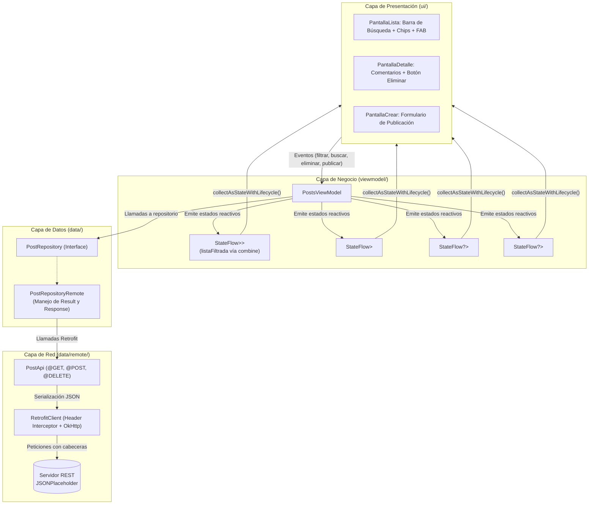
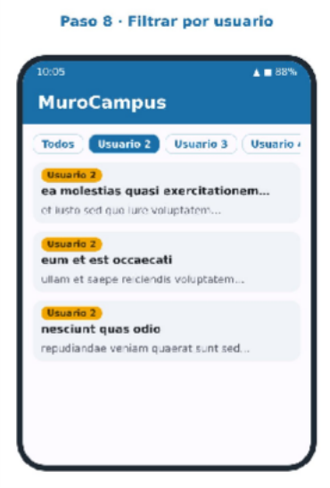
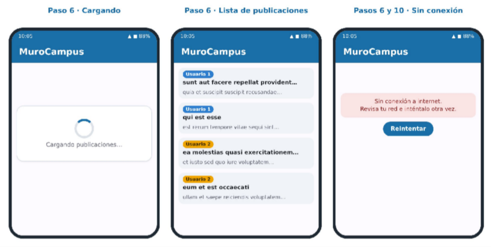

# MuroCampus (Con-IA) - Fase 2

MuroCampus es una aplicación Android profesional desarrollada con **Jetpack Compose**, **Retrofit**, **OkHttp**, **Kotlin Coroutines / Flow** y **Kotlinx Serialization** siguiendo la arquitectura **MVVM + Repository**. 

En esta **Fase 2 (Con IA)**, el proyecto evoluciona incorporando **3 mejoras técnicas avanzadas** asistidas por IA y auditadas bajo estrictos criterios de arquitectura limpia:
1. **Encabezado con Interceptor de OkHttp**: Inyección centralizada de cabeceras `Accept: application/json` y `User-Agent`.
2. **Borrado de Publicaciones con `@DELETE`**: Petición de eliminación en la API con `Response<Unit>`, verificación de código de respuesta en el Repositorio con `Result<Unit>`, actualización de estado en el ViewModel y diálogo modal de confirmación en la UI.
3. **Búsqueda Reactiva en Tiempo Real**: Filtrado de publicaciones descargadas en memoria en base a título y contenido mediante `combine` y `StateFlow`, integrado con barra de búsqueda con botón de limpieza en la vista.

---

## 🏛 Arquitectura MVVM + Repository (Fase 2)



---

## 📁 Estructura del Proyecto

```
com.tecsup.murocampus/
├── MainActivity.kt                     # Navegación declarativa entre LISTA, DETALLE y CREAR
├── model/
│   └── Modelos.kt                      # Modelos de datos: Post, Comentario, NuevoPost, Usuario
├── data/
│   ├── remote/
│   │   ├── PostApi.kt                  # Interface Retrofit con GET, POST y DELETE
│   │   └── RetrofitClient.kt           # Singleton de Retrofit con Interceptor de cabeceras y Logger
│   └── PostRepository.kt               # PostRepository y PostRepositoryRemote (Result<T> y Result<Unit>)
├── viewmodel/
│   ├── UiState.kt                      # Estados sellados (Cargando, Exito, Error) y función mensajeDe
│   ├── PostsViewModel.kt               # Gestión reactiva: listaFiltrada, detalle, filtro, crear y eliminar
│   └── PostsViewModelFactory.kt        # Factory para inyectar PostRepository al ViewModel
└── ui/
    ├── Componentes.kt                  # TarjetaPost, Cargando, ErrorConReintento
    ├── PantallaLista.kt                # Barra de búsqueda reactiva, chips por usuario y FAB
    ├── PantallaDetalle.kt              # Post completo, comentarios en paralelo y botón eliminar con Dialog
    ├── PantallaCrear.kt                # Formulario con validación en vivo y confirmación de creación
    └── theme/
        ├── Color.kt                    # Paleta de colores primarios y de estado
        ├── Theme.kt                    # Tema Material 3 MuroCampusTheme
        └── Type.kt                     # Tipografía
```

---

## 🚀 Mejoras Implementadas en la Fase 2

### 1. Interceptor de Encabezados en OkHttp (`data/remote/RetrofitClient.kt`)
* Implementación de un `Interceptor` en `OkHttpClient` que adjunta las cabeceras `Accept: application/json` y `User-Agent: MuroCampus-Android-Client/1.0` a todas las peticiones salientes.
* Asegura consistencia en la negociación de contenido HTTP con el servidor sin alterar la interface `PostApi`.

### 2. Borrado de Publicaciones con `@DELETE` (`API + Repository + ViewModel + View`)
* `PostApi`: Definición de `@DELETE("posts/{id}") suspend fun eliminar(@Path("id") id: Int): Response<Unit>`.
* `PostRepositoryRemote`: Inspección de `respuesta.isSuccessful` transformando el resultado a `Result<Unit>` y atrapando excepciones de red.
* `PostsViewModel`: Función `eliminar(id, onExito)` que actualiza `_eliminarEstado` y purga localmente el post de la lista en memoria para una sincronización instantánea.
* `PantallaDetalle`: Botón de papelera en la barra superior con `AlertDialog` de confirmación y feedback mediante `Snackbar` y `CircularProgressIndicator`.

### 3. Búsqueda Reactiva en Tiempo Real (`ViewModel + View`)
* `PostsViewModel`: Exposición de `listaFiltrada` generada mediante `combine(_lista, _busqueda) { ... }.stateIn(...)`, evaluando coincidencias en título o contenido en memoria sin peticiones de red redundantes.
* `PantallaLista`: Campo de búsqueda estilizado con iconos de lupa y botón para despejar la consulta, además de avisos dinámicos en caso de no hallar coincidencias.

---

## 📸 Capturas de Pantalla de la Aplicación

| Paso 6: Lista de Publicaciones | Paso 7: Detalle y Comentarios | Paso 8: Filtrar por Usuario |
|:---:|:---:|:---:|
|  |  |  |

| Paso 9: Crear Publicación | Pasos 6 y 10: Sin Conexión |
|:---:|:---:|
|  |  |

---

## 💡 Para Pensar: Respuestas a Preguntas de Reflexión

### 1. ¿Qué diferencia hay entre GET y POST? ¿Por qué crear lleva @Body y porUsuario lleva @Query?
* **GET vs POST**: `GET` solicita recursos del servidor de forma idempotente y segura a través de parámetros en la URL. `POST` transfiere una carga útil de datos dentro del cuerpo de la petición HTTP para generar o procesar un nuevo recurso en el servidor.
* **@Body vs @Query**: `@Body` serializa el objeto `NuevoPost` a JSON y lo aloja en el cuerpo HTTP. `@Query` añade un parámetro a la cadena de consulta en la URL (`/posts?userId=2`) para operaciones de filtrado.

### 2. ¿Por qué la ruta es "posts" y no "/posts"?
* La barra diagonal inicial reemplazaría la ruta base completa del host configurada en el cliente Retrofit (`baseUrl`). Usar una ruta relativa `"posts"` asegura que se concatene de forma correcta con `https://jsonplaceholder.typicode.com/`.

### 3. ¿Por qué el Repository devuelve Result en vez de dejar que la excepción llegue al ViewModel?
* Para preservar la arquitectura limpia y desacoplar el ViewModel de detalles de infraestructura (`IOException`, `HttpException`, OkHttp). El `Result<T>` estándar permite al ViewModel reaccionar a éxitos o fracasos de manera predecible y 100% testeable.

### 4. ¿Qué pasa si olvidas el permiso INTERNET? ¿Y si olvidas ignoreUnknownKeys y el servidor agrega un campo nuevo?
* Sin el permiso `INTERNET`, Android bloqueará la apertura de sockets de red arrojando un fallo de conectividad en tiempo de ejecución. Sin `ignoreUnknownKeys = true`, cualquier campo adicional devuelto por la API provocará un `SerializationException` abortando la deserialización.

### 5. ¿Por qué la pantalla de lista usa un when sobre UiState y no un if con tres variables?
* Un `sealed interface UiState` modela estados mutuamente excluyentes (Cargando, Éxito, Error) garantizando exhaustividad en el compilador y evitando combinaciones ilegales (como mostrar carga y error simultáneamente).

### 6. JSONPlaceholder no guarda los POST. ¿Cómo cambiaría tu app si usaras un servicio real?
* Un backend real persistiría el nuevo registro en su base de datos asignando un ID real; el cliente recibiría el código `201 Created` e insertaría la publicación directamente en la lista local o recargaría el muro desde el servidor, asociando la autoría al usuario autenticado.

---

Para más detalles sobre los prompts aplicados y los criterios de descarte de código autogenerado, consulta el archivo [PROMPTS.md](PROMPTS.md).
