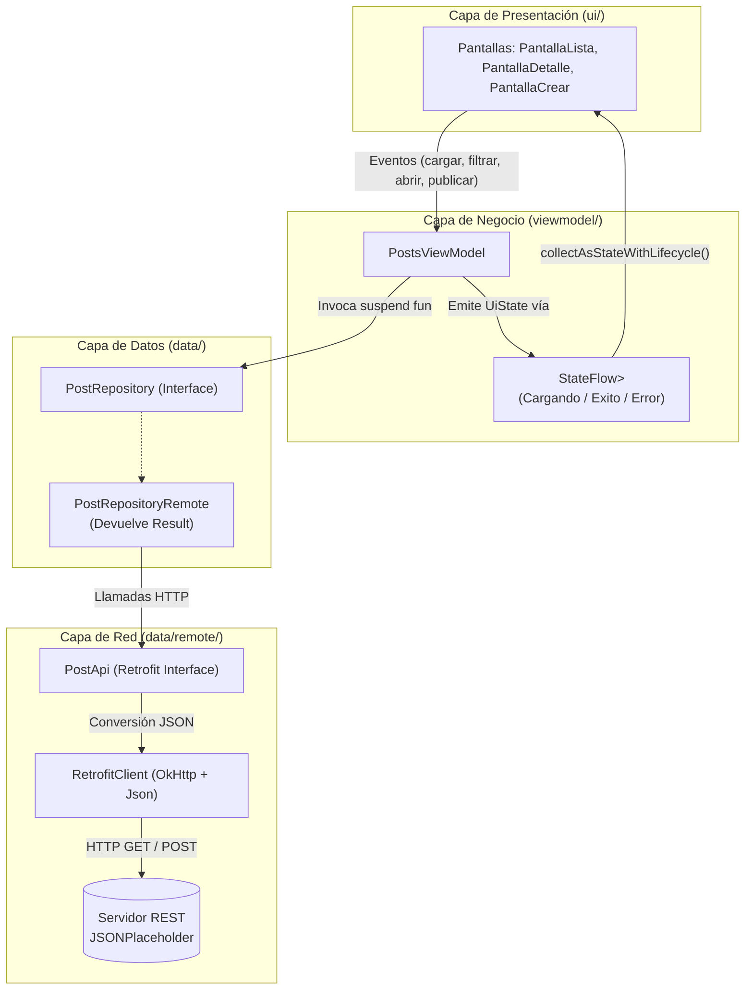
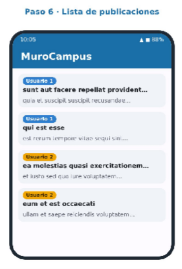
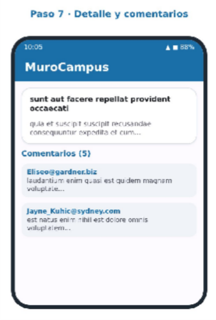
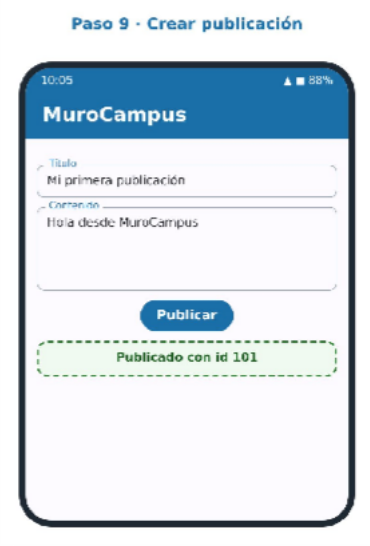

# MuroCampus (Sin-IA) - Fase 1

MuroCampus es una aplicación Android desarrollada con **Jetpack Compose**, **Retrofit**, **OkHttp** y **Kotlinx Serialization** siguiendo la arquitectura **MVVM + Repository**. La aplicación consume la API REST de JSONPlaceholder (`https://jsonplaceholder.typicode.com/`) para listar publicaciones, visualizar el detalle completo con comentarios, filtrar publicaciones por usuario y registrar nuevas publicaciones simuladas mediante peticiones HTTP seguras y reactivas.

---

## 🏛 Arquitectura MVVM + Repository

La arquitectura garantiza la separación de responsabilidades y la unidireccionalidad del flujo de datos:



### Reglas de Oro de la Arquitectura
* **UI**: Solo interactúa con su `ViewModel` consumiendo `StateFlow<UiState<T>>`. Nunca invoca a Retrofit ni a la capa remota.
* **ViewModel**: Solo conoce la interface `PostRepository`. No tiene referencias a Retrofit, `PostApi`, `HttpException` ni a `Context` de Android.
* **Repository**: Encapsula las excepciones de red (`IOException`, `HttpException`, etc.) y devuelve siempre `Result<T>`. Relanza `CancellationException` para permitir la cancelación estructurada de corrutinas.

---

## 📁 Estructura del Proyecto

```
com.tecsup.murocampus/
├── MainActivity.kt                     # Actividad principal con navegación declarativa
├── model/
│   └── Modelos.kt                      # Modelos serializables (Post, Comentario, NuevoPost, Usuario)
├── data/
│   ├── remote/
│   │   ├── PostApi.kt                  # Interface de Retrofit con @GET, @POST, @Path, @Query, @Body
│   │   └── RetrofitClient.kt           # Singleton de Retrofit con OkHttp, Logger y Json
│   └── PostRepository.kt               # Interface PostRepository e implementación PostRepositoryRemote con Result
├── viewmodel/
│   ├── UiState.kt                      # Estados sellados (Cargando, Exito, Error) y función mensajeDe
│   ├── PostsViewModel.kt               # Gestión de estados (lista, detalle, filtro, crear)
│   └── PostsViewModelFactory.kt        # Factory para inyectar PostRepository al ViewModel
└── ui/
    ├── Componentes.kt                  # TarjetaPost, Cargando, ErrorConReintento
    ├── PantallaLista.kt                # Lista de publicaciones con barra de chips de filtro y FAB
    ├── PantallaDetalle.kt              # Detalle completo con comentarios concurrentes y BackHandler
    ├── PantallaCrear.kt                # Formulario con validación en tiempo real y mensaje de confirmación
    └── theme/
        ├── Color.kt                    # Paleta de colores primarios azules y contenedores de estado
        ├── Theme.kt                    # Tema Material 3 MuroCampusTheme
        └── Type.kt                     # Tipografía personalizada
```

---

## 📸 Capturas de Pantalla

| Paso 6: Lista de Publicaciones | Paso 7: Detalle y Comentarios | Paso 8: Filtrar por Usuario |
|:---:|:---:|:---:|
|  |  |  |

| Paso 9: Crear Publicación | Paso 6 y 10: Sin Conexión a Internet |
|:---:|:---:|
|  |  |

---

## 🧪 Pruebas de Calidad y Manejo de Errores

| Prueba | Cómo provocarla | Resultado esperado | Estado |
|---|---|---|:---:|
| **Sin internet** | Activar modo avión y abrir la app | Muestra recuadro de error "Sin conexión a internet" con botón Reintentar | ✅ OK |
| **Reintentar** | Desactivar modo avión y presionar Reintentar | Descarga y visualiza las publicaciones exitosamente | ✅ OK |
| **Recurso inexistente** | Consultar `posts/9999` en el detalle | Captura `HttpException` (404) y muestra "Error del servidor (404)" | ✅ OK |
| **JSON inesperado** | Nuevas claves enviadas por el servidor | `ignoreUnknownKeys = true` evita fallos de deserialización | ✅ OK |
| **Cancelación** | Abrir detalle y presionar volver rápidamente | `CancellationException` se relanza adecuadamente sin crashear | ✅ OK |
| **Lista y detalle** | Abrir diversas publicaciones | Carga el post y sus 5 comentarios asociados | ✅ OK |
| **Filtro** | Seleccionar chips del Usuario 1 al 10 | Filtra reactivamente a 10 publicaciones por usuario; "Todos" devuelve 100 | ✅ OK |
| **Crear** | Formulario vacío vs completo | Botón deshabilitado si hay campos en blanco; al publicar muestra "Publicado con id 101" | ✅ OK |
| **Código limpio** | Inspección de `viewmodel/` | Totalmente desacoplado de Retrofit, PostApi y HttpException | ✅ OK |

---

## 💡 Para Pensar: Respuestas a Preguntas de Reflexión

### 1. ¿Qué diferencia hay entre GET y POST? ¿Por qué crear lleva @Body y porUsuario lleva @Query?
* **GET vs POST**:
  * `GET` se utiliza para solicitar y recuperar recursos del servidor sin alterar su estado (operación idempotente y segura). Sus parámetros viajan en la URL.
  * `POST` se utiliza para enviar datos al servidor con el fin de crear un nuevo recurso o procesar una acción. No es idempotente y los datos viajan dentro del cuerpo de la petición HTTP.
* **@Body vs @Query**:
  * `@Body` serializa un objeto completo (`NuevoPost`) a formato JSON y lo incrusta en el cuerpo de la petición HTTP (`request body`), necesario para que el servidor reciba la carga útil que dará origen al nuevo registro.
  * `@Query` añade un parámetro en la cadena de consulta de la URL (por ejemplo: `/posts?userId=2`). Se usa en operaciones de búsqueda o filtrado sin enviar un cuerpo en la petición.

### 2. ¿Por qué la ruta es "posts" y no "/posts"?
* Retrofit resuelve las rutas relativas combinándolas con la URL base (`baseUrl`). Si la URL base es `https://jsonplaceholder.typicode.com/` (con barra al final) y definimos `@GET("posts")`, la URL resultante es `https://jsonplaceholder.typicode.com/posts`.
* Si definiéramos `@GET("/posts")` con barra inicial, en la semántica de resolución de URLs de RFC 3986, la barra diagonal inicial sustituye toda la ruta base del host, lo cual puede romper subrutas o APIs con prefijos de versión (por ejemplo `https://api.com/v1/` se convertiría erróneamente en `https://api.com/posts` perdiendo el `/v1/`).

### 3. ¿Por qué el Repository devuelve Result en vez de dejar que la excepción llegue al ViewModel?
* Si el Repository permitiera que excepciones de red como `IOException` o `HttpException` se propaguen al `ViewModel`, el `ViewModel` tendría que acoplarse obligatoriamente a librerías de red externas para inspeccionar y manejar los tipos de error.
* Al encapsular la respuesta en la clase estándar `Result<T>` (`Result.success` o `Result.failure`), el Repository actúa como una frontera limpia: convierte la infraestructura técnica en datos de dominio que el `ViewModel` puede mapear fácilmente a `UiState.Error` sin conocer el cliente HTTP subyacente.

### 4. ¿Qué pasa si olvidas el permiso INTERNET? ¿Y si olvidas ignoreUnknownKeys y el servidor agrega un campo nuevo?
* **Sin el permiso INTERNET**: Android impide que el socket del sistema operativo abra conexiones externas. OkHttp fallará lanzando una excepción `SecurityException` o `UnknownHostException` en tiempo de ejecución, por lo que la aplicación no podrá conectarse a internet aunque el dispositivo tenga conectividad activa.
* **Sin ignoreUnknownKeys**: El deserializador de `kotlinx.serialization` requiere por defecto que cada clave presente en el JSON entrante tenga su correspondiente propiedad en la clase `@Serializable`. Si el backend añade un nuevo campo (por ejemplo `"updatedAt": "..."`), la aplicación lanzará inmediatamente una excepción `SerializationException: Encountered unknown key` y fallará.

### 5. ¿Por qué la pantalla de lista usa un when sobre UiState y no un if con tres variables?
* Usar tres variables booleanas separadas (por ejemplo `isLoading`, `isError`, `isSuccess`) permite combinaciones incoherentes o estados inválidos (por ejemplo, que `isLoading == true` y `isSuccess == true` ocurran al mismo tiempo).
* Un `sealed interface UiState<T>` modela una **Máquina de Estados Finita**: en cualquier instante de tiempo la pantalla solo puede encontrarse en exactamente uno de los estados mutuamente excluyentes (`Cargando`, `Exito` o `Error`). La sentencia `when` de Kotlin comprueba la exhaustividad en tiempo de compilación y garantiza que cada estado se dibuje de manera limpia y predecible.

### 6. JSONPlaceholder no guarda los POST. ¿Cómo cambiaría tu app si usaras un servicio real?
* **Persistencia en la base de datos**: Un servicio real almacenaría el nuevo registro en su motor de base de datos relacional o NoSQL y le asignaría un identificador autoincremental o UUID persistente.
* **Actualización del muro**: En una aplicación real, tras recibir la confirmación `201 Created` del servidor, el `ViewModel` insertaría de inmediato la publicación creada al principio de la lista en memoria (`_lista.value = UiState.Exito(listOf(postCreado) + listaActual)`) o volvería a solicitar `repo.listar()` para refrescar el muro con la información actualizada.
* **Autenticación real**: Un backend real exigiría un token de autenticación (como Bearer JWT) en las cabeceras HTTP para vincular la publicación al ID del usuario autenticado en lugar del valor simulado `userId = 1`.
