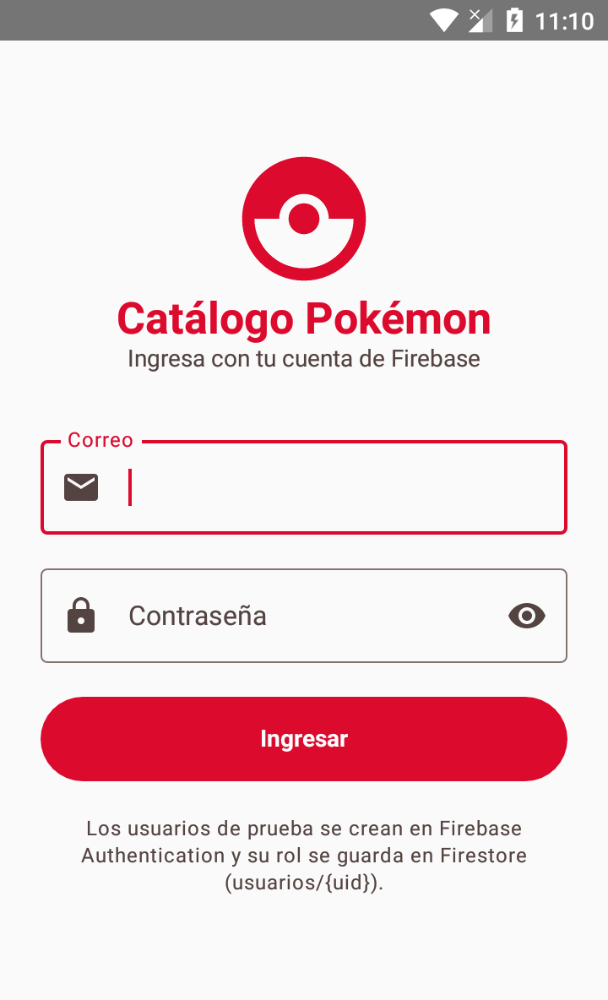
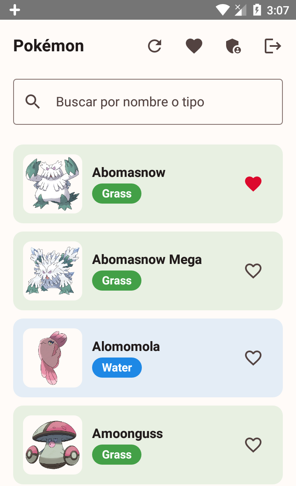
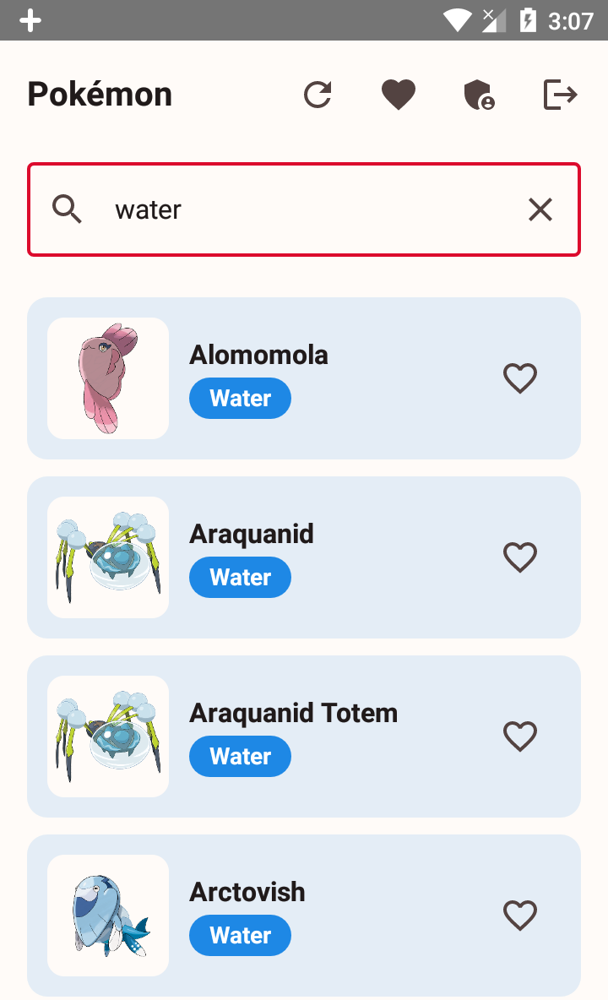
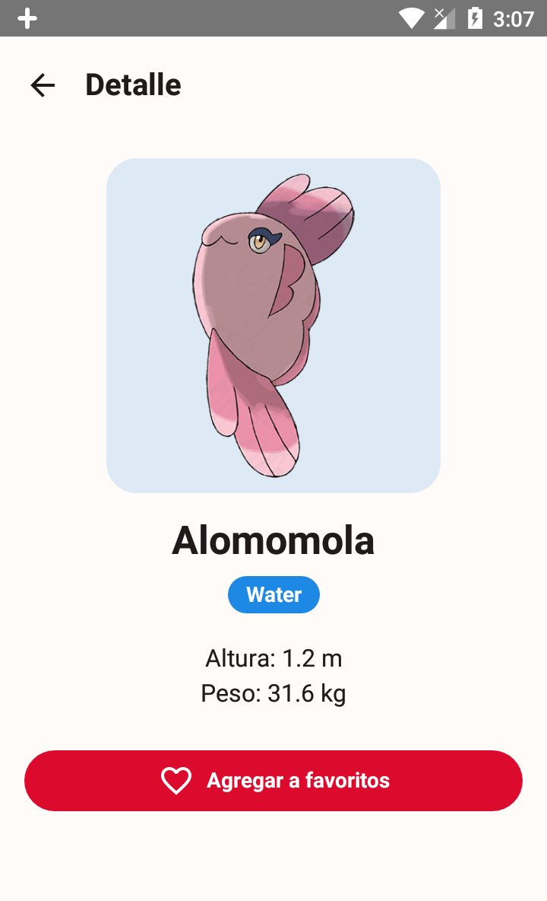
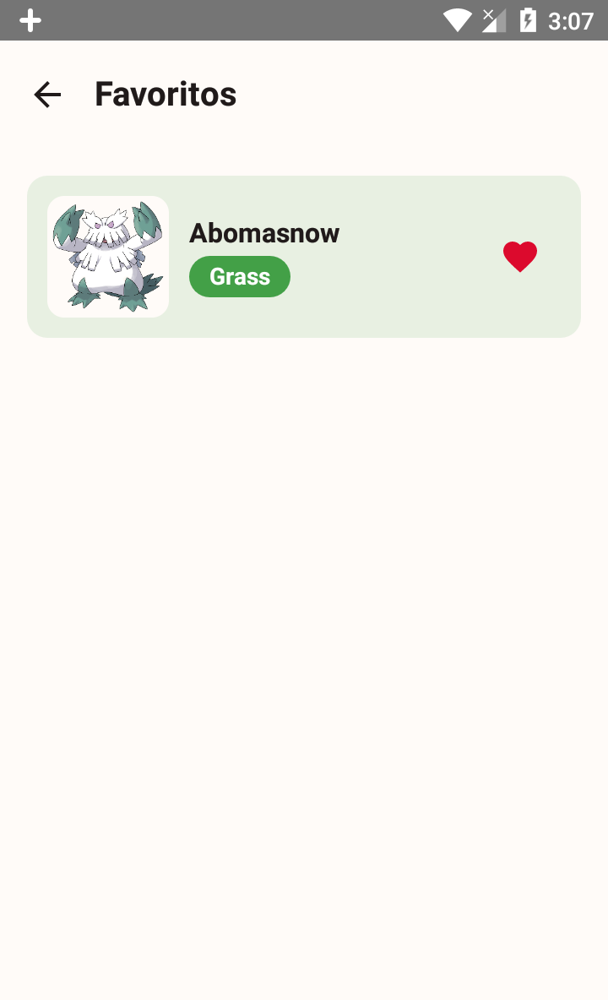
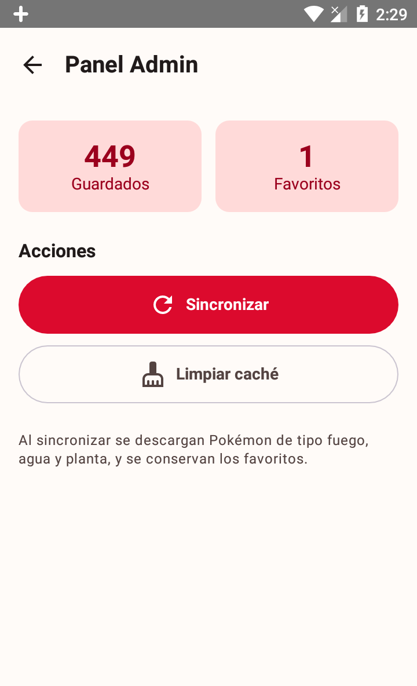
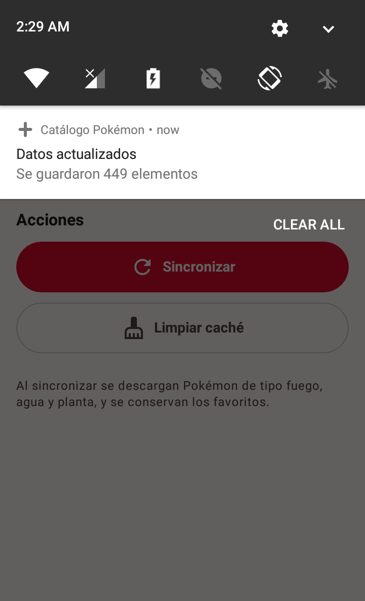

# Catálogo Pokémon — Laboratorio 11-12

Aplicación Android en Kotlin con **Jetpack Compose + MVVM + Retrofit + Room + Firebase Auth**.
Tema **Pokémon** con los tres tipos del grupo: fuego (`fire`), agua (`water`) y planta (`grass`).

> **Fase 2 (con IA).** Proyecto copiado de la Fase 1 (`Semana12/CatalogoPokemon(Sin IA)`,
> rama `Sin-IA`) sobre el que se aplican las mejoras asistidas por IA, las pruebas
> unitarias R12 y la documentación en `PROMPTS.md`.

## API

- Lista: `GET https://pokeapi.co/api/v2/type/{fire|water|grass}`
- Detalle: `GET https://pokeapi.co/api/v2/pokemon/{nombre}`

El `id` del modelo es el **nombre** del Pokémon (`String`), porque PokeAPI identifica
los Pokémon por nombre en la ruta de detalle.

## Estructura del proyecto

```
app/src/main/java/com/tecsup/catalogo/
├── MainActivity.kt
├── AppContainer.kt
├── data/
│   ├── remote/
│   │   ├── ApiService.kt
│   │   ├── RetrofitClient.kt
│   │   └── dto/ItemDto.kt
│   ├── local/
│   │   ├── ItemEntity.kt
│   │   ├── ItemDao.kt
│   │   └── AppDatabase.kt
│   ├── auth/
│   │   ├── AuthRepository.kt
│   │   └── FirebaseAuthRepository.kt
│   ├── repository/
│   │   ├── ItemRepository.kt
│   │   └── ItemRepositoryImpl.kt
│   └── mapper/Mappers.kt
├── domain/model/
│   ├── Item.kt
│   └── Sesion.kt
├── notification/
│   ├── Notificador.kt
│   └── NotificadorAndroid.kt
└── ui/
    ├── navigation/AppNav.kt
    ├── UiState.kt
    ├── login/LoginScreen.kt · LoginViewModel.kt
    ├── lista/ListaScreen.kt · ListaViewModel.kt
    ├── detalle/DetalleScreen.kt · DetalleViewModel.kt
    ├── favoritos/FavoritosScreen.kt · FavoritosViewModel.kt
    ├── admin/AdminScreen.kt · AdminViewModel.kt
    ├── components/Cargando.kt · ErrorView.kt · ItemCard.kt
    └── theme/

app/src/test/java/com/tecsup/catalogo/
├── MainDispatcherRule.kt
└── ui/lista/ListaViewModelTest.kt
```

## Proceso del proyecto

1. Se preparó la aplicación Android con Kotlin, Jetpack Compose y Material 3.
2. Se definieron los modelos de dominio y `UiState`, y se separó la lógica entre
   interfaz, ViewModels y repositorios.
3. Se conectó Retrofit con PokeAPI para descargar Pokémon de tipo fuego (`fire`),
   agua (`water`) y planta (`grass`), y obtener el detalle por nombre.
4. Se agregó Room como almacenamiento local para el catálogo y favoritos, de modo
   que la interfaz lee los datos guardados aunque no haya conexión.
5. Se integró Firebase Authentication y Firestore para iniciar sesión y obtener
   el rol (`admin` o `usuario`) desde `usuarios/{uid}`.
6. Se conectaron las pantallas de catálogo, detalle, favoritos y administración,
   y se añadió una notificación local al sincronizar.

**Fase 2 (con IA):**

7. Se agregó un buscador por nombre o tipo en la lista. El texto vive en
   `ListaViewModel`, filtra la lista que ya está en Room y no vuelve a llamar a la API.
8. Se mejoraron los mensajes de error (sin conexión, error del servidor e inesperado)
   y el estado vacío, con un botón para limpiar la búsqueda.
9. Se escribieron seis pruebas unitarias de `ListaViewModel` con repositorio y
   notificador falsos, y se documentaron las consultas a la IA en `PROMPTS.md`.

## Capturas de pantalla

### Login



### Lista de Pokémon



### Búsqueda por nombre o tipo



### Detalle



### Favoritos



### Panel Admin



### Notificación al sincronizar



## Cómo compilar

1. Abrir la carpeta `Semana12/CatalogoPokemon(Con IA)` en Android Studio.
2. Sincronizar Gradle.
3. Ejecutar en un emulador.

También se puede compilar desde la terminal:

```powershell
.\gradlew :app:assembleDebug
```

El APK de depuración queda en `app/build/outputs/apk/debug/app-debug.apk`.

## Configurar Firebase (obligatorio para iniciar sesión)

1. Crear un proyecto en <https://console.firebase.google.com>.
2. Registrar la app Android con el paquete exacto: `com.tecsup.catalogo`.
3. Descargar `google-services.json` y colocarlo dentro de `app/`.
   - El plugin de Google Services se aplica solo cuando ese archivo existe.
   - El archivo está en `.gitignore`: **no se sube al repositorio**. Cada integrante debe
     obtener su propio archivo para compilar.
4. Authentication → activar **Correo electrónico/contraseña**.
5. Crear dos usuarios de prueba: uno para admin y uno para usuario.
6. Firestore Database → colección `usuarios` → un documento por usuario.
   - El ID del documento debe ser el **UID** del usuario.
   - Campos: `rol` (`admin` o `usuario`) y `nombre`.
7. En Firestore → Reglas, permitir que cada persona lea solo su propio documento
   de rol. La app no necesita escribir en esta colección:

   ```javascript
   rules_version = '2';
   service cloud.firestore {
     match /databases/{database}/documents {
       match /usuarios/{uid} {
         allow get: if request.auth != null && request.auth.uid == uid;
       }
     }
   }
   ```

Sin `google-services.json` la app compila igual, pero el login muestra el aviso de que
Firebase no está configurado.

## Qué está incluido en esta fase

- Estructura de paquetes y contratos del laboratorio.
- `UiState` (`Cargando`, `Exito`, `Error`), modelo `Item`, `Sesion` y `Rol`.
- Retrofit con PokeAPI (lista y detalle) y mapeo DTO → Entity → modelo.
- Room como fuente única de verdad (Entity, Dao, Database).
- Repositorio como `interface` y conservación de favoritos al sincronizar.
- Login con Firebase Auth y rol leído desde Firestore.
- Navegación por rol y panel Admin con totales, sincronizar y limpiar caché.
- Notificación local al terminar de sincronizar (canal y permiso).
- Modo sin conexión: si hay datos guardados se muestran con aviso; si no, error con Reintentar.

**Mejoras de la Fase 2 (con IA):**

- Buscador por nombre o tipo que filtra la lista guardada, sin otra llamada a la API.
- Estado vacío distinto cuando la búsqueda no tiene coincidencias, con botón para
  limpiar el filtro.
- Colores por tipo de Pokémon en las tarjetas y en las etiquetas: fuego rojo, agua
  azul, planta y tierra verde, eléctrico amarillo, veneno morado, etc.
- Mensajes de error más claros (sin conexión, error del servidor, error inesperado) y
  pantalla de error con título, explicación y botón Reintentar.
- Seis pruebas unitarias de `ListaViewModel` con `ItemRepository` y `Notificador` falsos.

## Pruebas unitarias (R12)

Las pruebas están en `app/src/test/java/com/tecsup/catalogo/` y no usan Android,
Room ni internet: un repositorio falso y un notificador falso alimentan al ViewModel.

```powershell
.\gradlew :app:testDebugUnitTest
```

Cubren seis casos:

1. La lista guardada se publica como `UiState.Exito`.
2. Al sincronizar con éxito se notifica `Se guardaron N elementos`.
3. Sin conexión y sin caché se muestra `UiState.Error` con el mensaje de red.
4. Sin conexión con datos guardados se conserva la lista y se muestra el aviso.
5. El buscador filtra por nombre y por tipo.
6. Una búsqueda sin coincidencias devuelve una lista vacía.

## Reparto de tareas

| Integrante | Tareas |
| --- | --- |
| _(completar)_ | Estructura del proyecto, Retrofit, Room y pantallas de lista/detalle. |
| _(completar)_ | Firebase Auth/Firestore, roles, panel Admin, notificación, pruebas y README. |

## Entregables de la Fase 2 (con IA)

- Rama `Con-IA` (equivalente a `mejora-ia`) con los commits de la fase.
- `PROMPTS.md` con una entrada por consulta a la IA.
- Pruebas unitarias del ViewModel de la lista (R12).
- Pull Request de `Con-IA` hacia `main`.
- Versión `v1.0` con el APK de depuración adjunto en la entrega.
