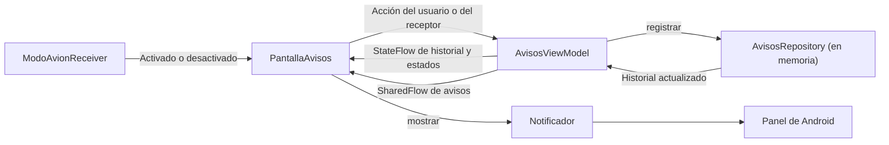
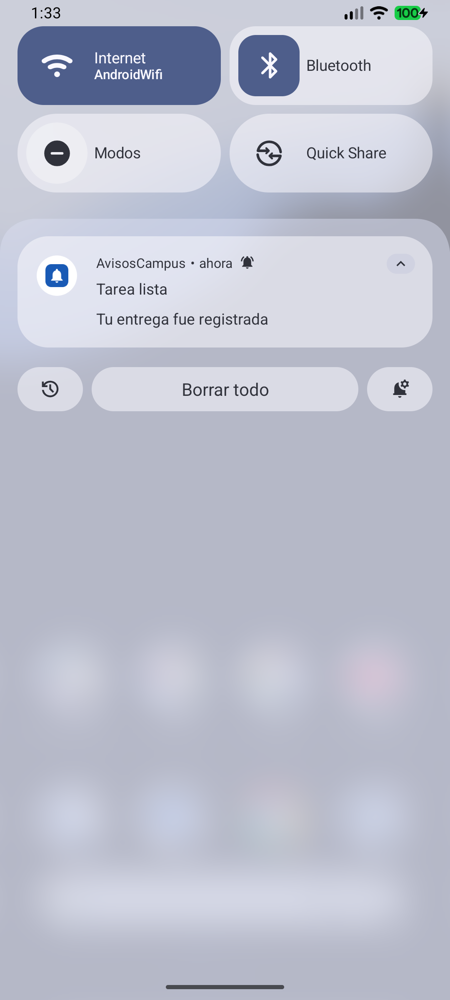
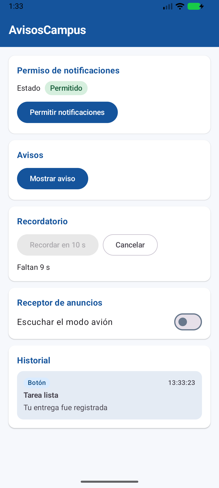
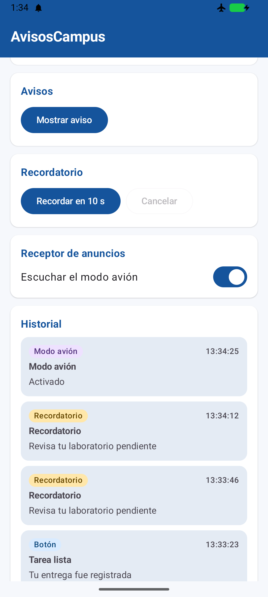
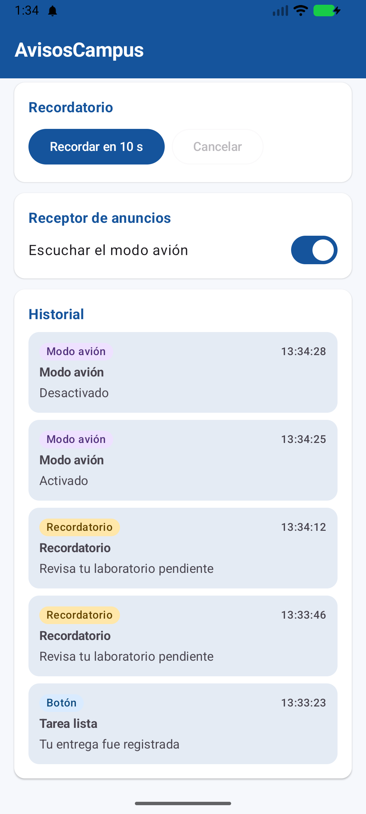
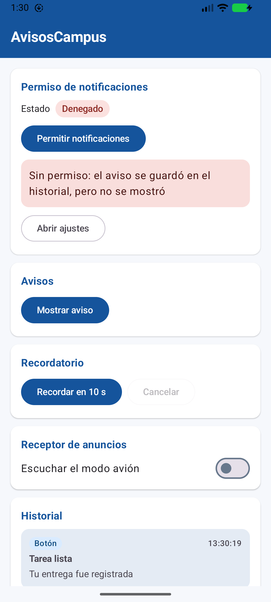

# AvisosCampus

Aplicación Android de la semana 15. Permite mostrar un aviso de entrega, programar un recordatorio para dentro de diez segundos y recibir avisos al activar o desactivar el modo avión. La pantalla muestra los últimos veinte avisos en orden cronológico inverso, incluso si se denegó el permiso para mostrarlos en el panel de Android.

## Ejecutar

Abre la carpeta que contiene este README en Android Studio, sincroniza Gradle y ejecuta `app`. También puedes compilar el APK de depuración con `./gradlew :app:assembleDebug` (`gradlew.bat :app:assembleDebug` en Windows). El proyecto usa el SDK de compilación 37 y admite dispositivos desde Android 7.0 (API 24). Para probar el diálogo de permiso, usa Android 13 (API 33) o superior.

## Paquetes

```text
com.tecsup.avisoscampus/
├── AvisosApp.kt                   Crea el canal Avisos al iniciar el proceso
├── MainActivity.kt                Aloja la pantalla Compose
├── data/
│   └── AvisosRepository.kt        Contrato e implementación del historial en memoria
├── model/
│   └── Modelos.kt                 Aviso, Origen y PermisoUi
├── notificacion/
│   └── Notificador.kt             Comprueba el permiso y publica en el panel de Android
├── receiver/
│   └── ModoAvionReceiver.kt       Entrega el estado del modo avión a la pantalla
├── ui/
│   ├── PantallaAvisos.kt          Botones, permiso y registro del receptor
│   ├── HistorialAvisos.kt         Muestra origen, título, texto y hora
│   └── theme/Theme.kt             Colores de Material 3
└── viewmodel/
    ├── AvisosViewModel.kt         Decide los avisos y controla la cuenta regresiva
    └── AvisosViewModelFactory.kt  Proporciona el repositorio al ViewModel
```

## Cómo llega un aviso al panel



El ViewModel registra el aviso antes de emitir el evento. Si Android deniega el permiso, la entrada ya está en el historial y la pantalla ofrece abrir Ajustes. El historial y la cuenta regresiva sobreviven a la rotación. Ambos viven en memoria mientras exista el ViewModel. El recordatorio puede llegar con la app minimizada, pero cerrar su proceso interrumpe la cuenta.

## Capturas del emulador

| Panel de notificaciones | Recordatorio en curso |
| --- | --- |
|  |  |

| Modo avión | Historial | Permiso denegado |
| --- | --- | --- |
|  |  |  |

## Pruebas de aceptación

Verificadas en un emulador con Android 16 (API 36), con datos ficticios.

| Acción | Resultado observado |
| --- | --- |
| Abrir los ajustes de notificaciones de AvisosCampus | Aparece el canal Avisos. |
| Pulsar **Permitir notificaciones** | Android muestra el diálogo del sistema y la etiqueta refleja la respuesta. |
| Pulsar **Mostrar aviso** | El panel muestra **Tarea lista** con el texto de la entrega. |
| Pulsar dos veces **Mostrar aviso** | Android conserva dos avisos con identificadores distintos. |
| Tocar uno de los avisos desde el panel | Se abre la app y desaparece el aviso seleccionado. |
| Iniciar **Recordar en 10 s** | Se muestra la cuenta regresiva y llega una notificación al terminar. |
| Minimizar la app durante la cuenta | El recordatorio llega al panel. |
| Cancelar antes de que termine la cuenta | Al cumplirse el plazo no aparece ningún aviso nuevo. |
| Activar la escucha y cambiar el modo avión | El historial registra **Activado** y luego **Desactivado**. |
| Cambiar el modo avión con la escucha apagada | No se genera un aviso. |
| Denegar el permiso y pulsar **Mostrar aviso** | La app sigue abierta, guarda la entrada y ofrece abrir Ajustes. Al conceder el permiso, desaparece el mensaje. |
| Rotar durante la cuenta | El recordatorio continúa y el historial se conserva. |
| Revisar ViewModel y receptor | El ViewModel depende de la interfaz del repositorio. El receptor registrado en la pantalla se retira en `onDispose`. |

## Para pensar

1. **¿Por qué hacen falta un canal y un permiso?** Desde Android 8, el canal agrupa los avisos y permite al usuario controlar su importancia y sonido. Si falta el canal, Android omite la notificación de esta app. Desde Android 13 también se necesita el permiso `POST_NOTIFICATIONS`. Si se deniega, el aviso se guarda en el historial local y aparece la opción de abrir Ajustes.
2. **¿Por qué el ViewModel emite un evento?** El ViewModel decide qué ocurrió y registra el aviso. La pantalla recibe el evento una sola vez y usa su contexto para llamar al notificador. Así se puede probar la decisión de registrar o emitir un aviso sin crear una actividad.
3. **¿Qué ocurre al repetir el identificador?** Para la misma app y etiqueta, Android actualiza la notificación existente. Cada aviso de esta sesión recibe un identificador propio, por lo que dos entregas pueden coexistir en el panel.
4. **¿Por qué debe ser corto `onReceive` y por qué retirar el receptor?** Android ejecuta este receptor en el hilo principal. Un trabajo largo puede bloquear la interfaz y provocar un error de aplicación sin respuesta. Al apagar el interruptor o salir de la composición, `onDispose` retira el receptor para que deje de recibir eventos y libere la referencia a la actividad.
5. **¿Cuándo conviene una notificación local o una push?** Una local sirve para un hecho que el teléfono ya conoce, como el vencimiento de este recordatorio. Una push de Firebase sirve para un hecho que nace en un servidor, como un cambio de aula publicado por el docente después de que el alumno cerró la app.
